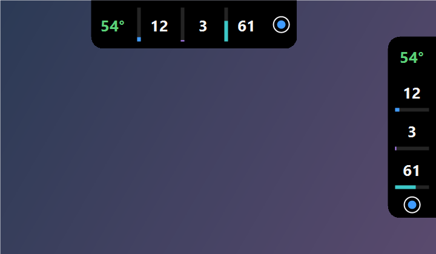

# Design — ThermoBook

## Norte

**"O termômetro no canto."** Uma cápsula preta e discreta que se lê em meio segundo: o número da temperatura muda de cor antes de você sentir o notebook esquentar. Tudo o mais (modos, ferramentas) está a um clique, nunca na frente.

Referência de forma: a pílula de ícones do OpenUsage para Windows (cápsula preta vertical, ícones empilhados, presa à borda). O ThermoBook troca ícones de provedor por métricas.

## Cores

Fundo preto puro (AMOLED), estrutura em carvão, uma cor por métrica. As cores de temperatura são as mesmas do ícone da bandeja da v0.1 (`TrayIconRenderer.cs`), para os dois falarem a mesma língua.

| Token | Uso |
|---|---|
| `background` `#000000` | Pílula, painel rápido |
| `raised` `#141414` | Botões, segmentos, flyout |
| `border` / `track` `#242424` | Divisórias, fundo dos medidores |
| `foreground` `#F4F4F6` | Valores |
| `muted` `#A9ABB5` | Rótulos e unidades |
| `temp-ok` `#5AD278` | Temperatura abaixo de 75 °C |
| `temp-warm` `#FFA53C` | 75 a 89 °C |
| `temp-hot` `#FF5555` | 90 °C ou mais (mesmo limite do alerta padrão) |
| `cpu` / `gpu` / `ram` | Medidor de cada métrica (mesmas cores do painel da v0.1) |
| `accent` `#409CFF` | Modo selecionado, foco do teclado |

Regra: vermelho e laranja só aparecem para temperatura e alertas. Uso alto de CPU não fica vermelho.

## Tipografia

Segoe UI Variable. Na pílula: valor 13 px negrito com números tabulares (não "pula" quando muda de 9 para 10), unidade 8 px em `muted`. Nunca abaixo de 8 px lógicos.

## Componentes

### Pílula (estado padrão)

```
 ╭────╮
 │ 54°│  temperatura (cor por limiar)
 │ ── │
 │ 12 │  CPU %   ▏medidor de 3 px na cor da métrica
 │  3 │  GPU %
 │ 61 │  RAM %
 │  8 │  Disco %
 │ ── │
 │  ● │  modo atual (ponto; anel quando segundo plano está ligado)
 ╰────╯
```

- Largura 40 px lógicos na vertical; cada linha de métrica 32 px; cantos com raio de 10 px (não é cápsula completa).
- Vertical quando presa a uma borda lateral; **horizontal** (mesmos itens lado a lado) quando presa ao topo ou à base.
- Cada métrica: número + um medidor fino de 3 px (horizontal em baixo do número na vertical, à esquerda na horizontal) com a porcentagem.
- Sem sombra, sem transparência, sem borda (legível sobre qualquer papel de parede).
- **Notch**, como o OpenUsage: encostada na tela, sem folga; os cantos do lado da borda ficam retos e os de dentro arredondados (no canto da tela, só o canto de dentro arredonda). Cantos por `Region` própria; o arredondamento e o contorno claro do DWM do Windows 11 ficam desligados.
- Indicador de modo: ponto de 7 px na cor do modo (Economia verde, Frio azul, Eficiência ciano, Equilibrado branco, Alto e Máximo roxo, Personalizado cinza; nunca vermelho ou laranja); quando o **modo segundo plano** está ligado, ganha um anel ao redor (lembrete de que a tampa não suspende).


- Valores indisponíveis mostram `–`, nunca `0`.

### Flyout (passar o mouse)

Abre ao lado da pílula, oposto à borda, após 300 ms. Mostra o detalhe que não cabe na pílula: temperatura por zona, GHz e se está em turbo, GPU 3D/vídeo, RAM em GB, disco, nome do modo e "Segundo plano: ligado/desligado". Some ao tirar o mouse (150 ms de tolerância).

### Painel rápido (clique)

Cartão de 280 px, raio 14 px nos 4 cantos (sem o contorno do DWM, como o flyout), fundo `background`, ancorado à pílula pelo mesmo cálculo do flyout.

1. **Modos**: grade 3×2 de 6 botões com o nome (Economia, Frio, Eficiência, Equilibrado, Alto, Máximo), sem ícone. Selecionado em `accent`. Passar o mouse mostra a descrição.
2. **Ações**: três botões lado a lado — *Segundo plano* (alternância, escreve "ligado"/"desligado"), *Desligar tela*, *Ferramentas* (abre o painel completo na aba Ferramentas).
3. Rodapé: "Abrir painel completo" (as configurações ficam na aba do painel completo; não há engrenagem).

Fecha com Esc, clique fora ou novo clique na pílula.

### Menu do botão direito

O mesmo menu da bandeja (um só `ContextMenuStrip` para os dois): status, Abrir painel, os 6 modos, Modo segundo plano, Desligar a tela, Ferramentas..., Mostrar pílula, Ventoinha, Iniciar com o Windows, Sair. Não há "Fixar posição".

### Painel completo

O painel da v0.1 (cartões + gráficos) ganha abas: **Monitor**, **Modos**, **Ferramentas**, **Configurações**. Mesmo fundo preto da pílula (`#000000`); cartões e botões em `raised`.

- Abas no jeito do OpenUsage: faixa de botões de segmento no topo, sem fundo; a aba ativa ganha fundo `raised` e negrito. Ctrl+Tab / Ctrl+Shift+Tab trocam de aba. Embaixo, o rodapé com a hora da última leitura em `muted`.
- **Modos**: os 6 modos, um por linha, com a descrição ao lado; o atual em `accent`. Embaixo, "Avançado" (turbo e limite à mão, vira "Personalizado") e o botão da ventoinha Samsung quando o app existe.
- **Ferramentas**: limpeza (Lixeira desmarcada, pede confirmação) e otimização do Windows (Aplicar ajustes, Desfazer ajustes, status do Defender no fim).
- **Configurações**: pílula, atalho para desligar a tela, alerta (°C, segundos, trocar para Frio) e iniciar com o Windows. Salva na hora.

## Comportamento

- **Arrastar** pela pílula inteira; ao soltar a até 24 px de uma borda, encaixa na borda (e no canto, se perto dos dois). Posição salva por monitor (identificado pelo nome do dispositivo + resolução).
- **Nunca rouba o foco**: a pílula não ativa a janela ao ser clicada (`WS_EX_NOACTIVATE`), não aparece na barra de tarefas nem no Alt+Tab (`WS_EX_TOOLWINDOW`).
- **Sempre visível**, exceto quando um app está em tela cheia (jogo, vídeo, apresentação): a pílula se esconde e volta sozinha.
- **Atualização**: a cada segundo, sem piscar (double buffer, só redesenha se algum valor mudou).
- **DPI**: PerMonitorV2; tamanhos acima são lógicos e escalam por monitor.

## Acessibilidade

- Cada linha da pílula tem nome acessível ("Temperatura 54 graus", "CPU 12 por cento").
- Painel rápido navegável por Tab/setas; Enter aplica; Esc fecha. Foco visível em `accent`.
- Contraste do texto `foreground` sobre preto > 15:1; `muted` > 7:1.
- Cor nunca é a única pista: o flyout escreve "quente"/"quente demais" ao lado do número.

## Não fazer

- Gradientes, vidro/blur, sombras grandes, animações longas (máx. 120 ms de fade).
- Ícones de marca de terceiros.
- Mais de 5 linhas na pílula. Métrica nova vai para o flyout.
