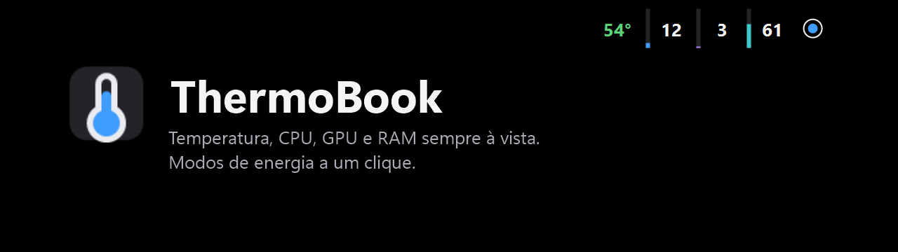
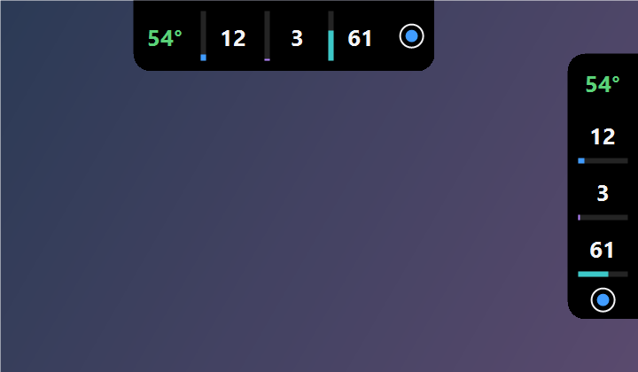
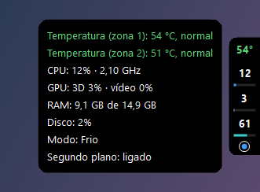
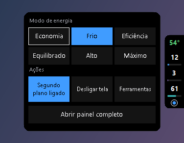
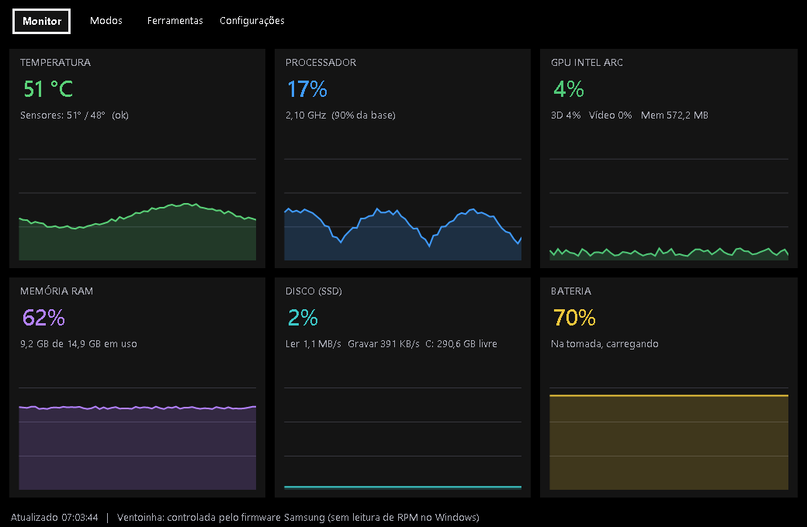
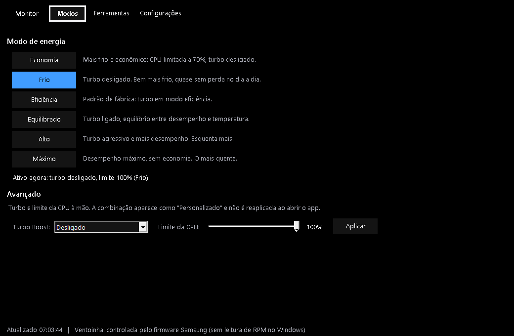
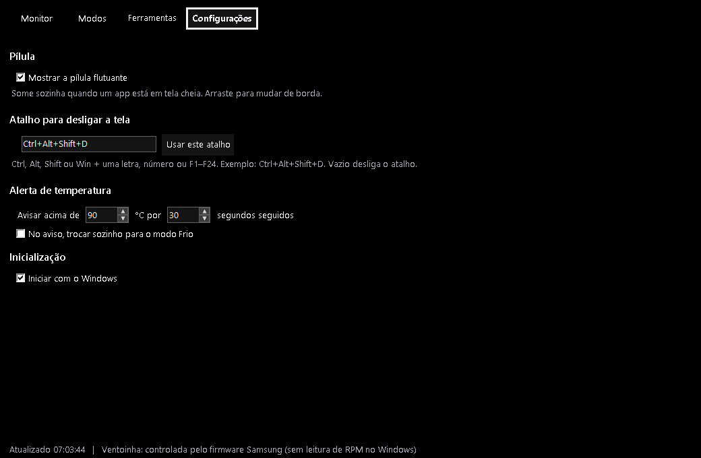
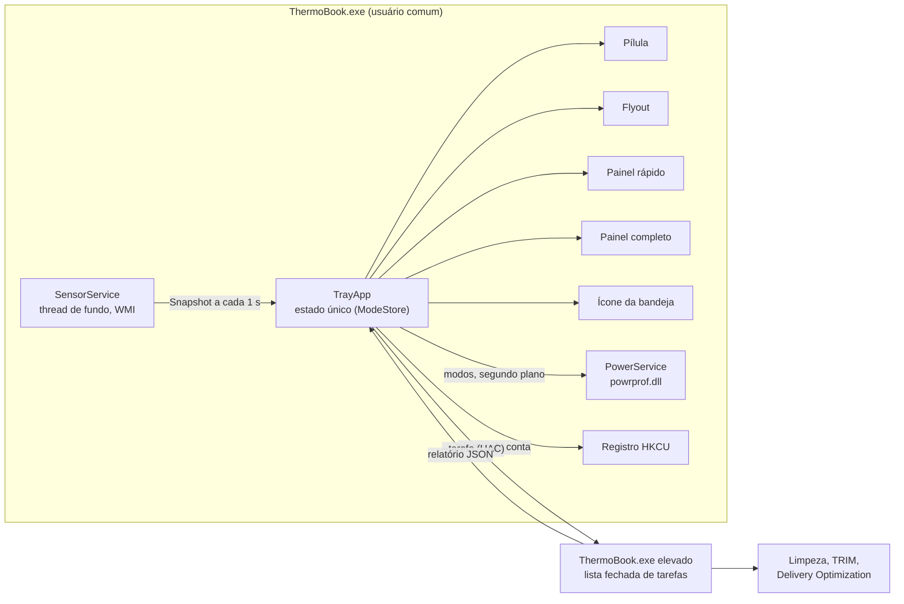

<p align="center">
  
</p>

<p align="center">
  <a href="https://github.com/playertwo1/thermobook/releases"></a>
  <a href="https://github.com/playertwo1/thermobook/actions/workflows/build.yml"></a>
  
</p>

<p align="center">
  <a href="#instalar">Instalar</a> ·
  <a href="#como-usar">Como usar</a> ·
  <a href="#como-funciona">Como funciona</a> ·
  <a href="#compilar">Compilar</a> ·
  <a href="docs/ROADMAP.md">Roadmap</a>
</p>

**ThermoBook** é uma pílula flutuante para Windows que mostra **temperatura, CPU, GPU e RAM** o tempo todo, presa à borda da tela, e troca o **modo de energia** do processador com um clique. Feito para notebooks finos que esquentam: no notebook de testes (Samsung Galaxy Book6 Pro), o modo **Frio** baixou a temperatura sob carga de **83–86 °C para 54–57 °C**.

Ele substitui uma pasta de scripts `.bat`/`.ps1` (modos de energia, tampa fechada sem suspender, desligar a tela, limpeza, otimização) por um app só, **sem rodar como administrador** e **sem driver de kernel**.

> **Estado:** a [v0.1.0](https://github.com/playertwo1/thermobook/releases/tag/v0.1.0) (bandeja e painel) é a versão estável. A **v0.2** (pílula, 6 modos, segundo plano, ferramentas) está no [pré-lançamento v0.2.0-beta.1](https://github.com/playertwo1/thermobook/releases/tag/v0.2.0-beta.1) e em [verificação no notebook](docs/VERIFICACAO.md).

## Sumário

- [O que faz](#o-que-faz)
- [Instalar](#instalar)
- [Como usar](#como-usar)
- [Como funciona](#como-funciona)
- [Limites conhecidos](#limites-conhecidos)
- [Compilar](#compilar)
- [Organização do repositório](#organização-do-repositório)
- [Contribuir](#contribuir)

## O que faz

| | |
|---|---|
| **Pílula** | Temperatura com cor por limiar (verde < 75 °C, laranja até 89 °C, vermelho a partir de 90 °C), CPU, GPU e RAM com medidor, e um ponto com o modo atual. Encaixa em qualquer borda ou canto como um notch; some com app em tela cheia; não rouba o foco nem aparece no Alt+Tab. |
| **6 modos de energia** | Economia, Frio, Eficiência, Equilibrado, Alto e Máximo. Gravam turbo, limites de CPU, EPP, núcleos e disco ocioso no plano ativo. |
| **Modo segundo plano** | Tampa fechada e inatividade não suspendem o PC. Guarda os valores originais de cada plano e devolve exatamente esses ao desligar. |
| **Desligar a tela** | Botão no painel rápido e atalho global `Ctrl+Alt+Shift+D` (configurável). |
| **Ferramentas** | Limpeza de temporários, cache do Windows Update e DNS; otimização do Windows em itens marcáveis (privacidade, desempenho, TRIM, apps pré-instalados) com **Desfazer**. Só o que é de máquina pede UAC, na hora do clique. |
| **Alerta** | Aviso quando a temperatura passa do limite por um tempo, com opção de trocar sozinho para o modo Frio. |

<p align="center">
  
</p>

## Instalar

1. Baixe o `ThermoBook-Setup-<versão>.exe` em [Releases](https://github.com/playertwo1/thermobook/releases).
2. Rode o instalador. Ele instala **só para o seu usuário**, sem pedir administrador, e já traz o .NET embutido.
3. O Windows SmartScreen pode avisar "Editor desconhecido" (o instalador não é assinado): **Mais informações → Executar assim mesmo**.

**Requisitos:** Windows 10 versão 2004 ou mais novo, x64. Feito e testado no Windows 11; os cantos da pílula e o modo escuro da janela pedem o Windows 11.

**Desinstalar** (Configurações → Apps) devolve o PC como estava: desliga o modo segundo plano, desfaz os ajustes da otimização (os de máquina pedem UAC), volta o processador ao modo Eficiência e remove o "Iniciar com o Windows" e as configurações.

## Como usar

| Ação | Onde |
|---|---|
| Ver o detalhe (zonas de temperatura, GHz, turbo, RAM em GB, disco) | Passar o mouse na pílula |
| Trocar modo, segundo plano, desligar a tela | Clicar na pílula (painel rápido, funciona só com teclado) |
| Mover a pílula | Arrastar e soltar perto de uma borda ou canto |
| Menu completo | Botão direito na pílula ou no ícone da bandeja |
| Gráficos, modos com descrição, ferramentas, configurações | **Abrir painel completo** |

<table>
  <tr>
    <td></td>
    <td></td>
  </tr>
  <tr>
    <td align="center">Passar o mouse: flyout</td>
    <td align="center">Clicar: painel rápido</td>
  </tr>
</table>

<p align="center">
  
  <br><sub>Painel completo, aba Monitor</sub>
</p>

<details>
<summary>Abas Modos e Configurações</summary>





</details>

As imagens são o desenho real das janelas do app, geradas com dados de exemplo.

### Os modos

| Modo | Para quê | Turbo | CPU máx. |
|---|---|---|---|
| Economia | Bateria e silêncio | desligado | 70% |
| Frio | Dia a dia sem esquentar | desligado | 100% |
| Eficiência | Padrão de fábrica do notebook | eficiência | 100% |
| Equilibrado | Equilíbrio entre desempenho e temperatura | ligado | 100% |
| Alto | Mais desempenho | agressivo | 100% |
| Máximo | Tudo no máximo | agressivo | 100% |

Valores completos (CPU mínima, EPP, núcleos, disco) no [ROADMAP 7.2](docs/ROADMAP.md#72-catálogo-de-modos). Se o modo for trocado por fora (Configurações do Windows), o app mostra **Personalizado**; se o plano de energia mudar, ele reaplica o modo salvo.

### Linha de comando

```
ThermoBook.exe --diagnostico   # sensores e tabela do modo atual (valor no plano x esperado)
ThermoBook.exe --bandeja       # abre só na bandeja, sem o painel
```

Em PowerShell, use `& .\ThermoBook.exe --diagnostico | Out-String` para ver a saída no terminal.

## Como funciona



- **Sensores** só na thread de fundo; a interface lê o último `Snapshot`. Temperatura vem das zonas térmicas ACPI (WMI), sem driver.
- **Energia** pela API do Windows (`powrprof.dll`), nunca chamando `powercfg.exe`. Os modos são gravados no plano ativo, não num GUID fixo.
- **Um só estado**: bandeja, pílula, painel rápido e painel completo recebem a mudança por evento e atualizam juntos.
- **Administrador só num processo separado**: o app relança a si mesmo com `--tarefa <nome>`; o processo elevado aceita só nomes de uma lista fechada, faz a tarefa, grava um relatório e sai.
- **Tudo reversível**: o valor anterior é guardado antes de gravar (`%AppData%\ThermoBook\settings.json` para o que é da conta; `HKLM\SOFTWARE\ThermoBook` para o que é de máquina). O que não tem volta (esvaziar a Lixeira, remover apps) fica desmarcado e pede confirmação.

Decisões e o porquê de cada uma em [docs/STATE.md](docs/STATE.md#decisões-tomadas-v02); visual em [DESIGN.md](DESIGN.md).

## Limites conhecidos

- **Temperatura da GPU** integrada (Intel Arc) não é exposta sem driver: a pílula mostra só o uso.
- **Temperatura da CPU** vem das zonas ACPI, não do sensor por núcleo.
- **Overlay do modo de energia do Windows** só pega com o plano Equilibrado ativo; fora dele os valores do processador valem mesmo assim.
- **Ventoinha** é do firmware Samsung; o app só abre o app de configurações Samsung quando ele existe.
- **Instalador sem assinatura** (SmartScreen) e `.exe` de ~135 MB (.NET embutido e o SDK do Windows para remover apps).

Lista completa em [PRODUCT.md](PRODUCT.md#limites-conhecidos).

## Compilar

Precisa do [.NET 10 SDK](https://dotnet.microsoft.com/download/dotnet/10.0) no Windows.

```
dotnet build -c Release
dotnet test -c Release
dotnet run --project src/ThermoBook
```

Instalador (precisa do Inno Setup 6: `winget install JRSoftware.InnoSetup`):

```
dotnet publish src/ThermoBook -c Release -r win-x64 --self-contained -p:PublishSingleFile=true -o publish
ISCC installer\ThermoBook.iss
```

O instalador sai em `installer\Output\`. Uma tag `v*` enviada ao GitHub dispara o [`release.yml`](.github/workflows/release.yml), que testa, gera o instalador e publica a Release (tag com hífen, como `v0.2.0-beta.1`, sai como pré-lançamento).

## Organização do repositório

| Caminho | O quê |
|---|---|
| [`src/ThermoBook/`](src/ThermoBook) | App WinForms: bandeja (`TrayApp`), pílula (`PillForm`, `PillLayout`, `PillDock`), flyout, painel rápido e painel completo |
| [`src/ThermoBook/Services/`](src/ThermoBook/Services) | Sensores, energia, segundo plano, atalho, limpeza, otimização, tarefas elevadas, desinstalação |
| [`tests/ThermoBook.Tests/`](tests/ThermoBook.Tests) | Testes xUnit (lógica de encaixe, modos, snapshot do segundo plano, parser das tarefas, registro com chave falsa) |
| [`installer/`](installer) | Script do Inno Setup |
| [`docs/`](docs) | [Roadmap](docs/ROADMAP.md), [estado atual](docs/STATE.md), [mapa de arquivos](docs/INDEX.md), [checklist de verificação](docs/VERIFICACAO.md) |
| [`prototype/`](prototype) | Protótipo original em PowerShell |

## Contribuir

O trabalho segue o [ROADMAP](docs/ROADMAP.md), uma subfase por vez, com teste para toda lógica nova e interface em português do Brasil. Regras de arquitetura (sem administrador no app principal, sem driver, sem `powercfg`/PowerShell por processo, toda mudança reversível) estão no [AGENTS.md](AGENTS.md), que vale para pessoas e agentes de código.
